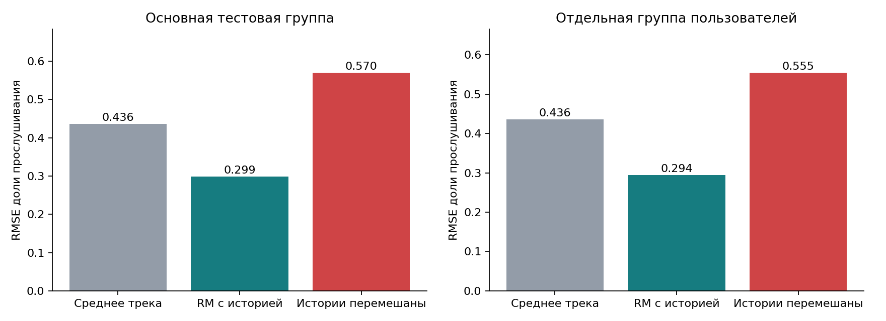
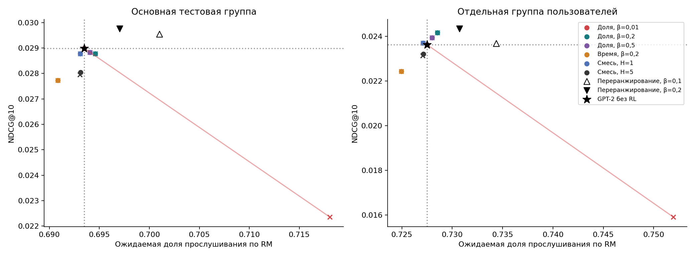
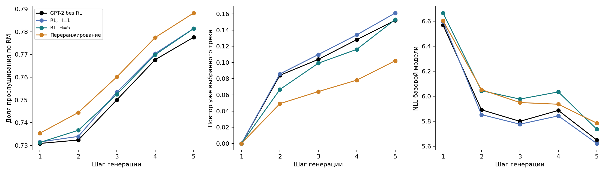

# Влияние RL-дообучения на последовательные рекомендации

## 1. Постановка задачи

Цель исследования — выяснить, можно ли повысить ожидаемое вознаграждение последовательной
рекомендательной модели, сохранив релевантность её рекомендаций. Задача рассматривается на
истории прослушиваний музыки: GPT-2 предсказывает следующий трек, а модель вознаграждения
(reward model, RM) оценивает предполагаемую долю прослушивания и вероятность продолжения
взаимодействия.

Сравниваются базовая GPT-2 и её варианты после RL-дообучения. Основные вопросы — как меняются
выбор треков и точность, возникает ли концентрация на одних и тех же объектах, чем отличаются
цели «дослушать трек» и «слушать дольше» и что происходит при последовательной генерации пяти
рекомендаций.

## 2. Данные и оценка

Используется Yambda, файл `flat/50m/listens.parquet`, содержащий 46,47 млн прослушиваний.
Основная подвыборка включает 916 пользователей и 4,48 млн событий. Пользователи отбираются
детерминированным хешированием идентификаторов. Каталог состоит из 4096 наиболее частых треков
обучающей части. Их идентификаторы служат токенами; отдельные токены обозначают заполнение и
неизвестный трек.

Разбиение хронологическое: первые 70% событий по времени относятся к обучению, следующие 15% — к
валидации, оставшиеся 15% — к тесту. Границы времени в единицах источника: 19 934 415 и 23 086
205 секунд. Контекст включает до 24 событий, произошедших строго раньше целевого; события с
равным временем исключаются. Словарь и статистики треков рассчитываются только на обучающей
части. Доля прослушивания ограничена диапазоном от 0 до 1.

Для оценки продолжения сессии используется признак следующего события в течение 30 минут.
Последние 1800 секунд каждой части исключаются из целевых примеров, чтобы неполное наблюдение
будущего не превращалось в отрицательную метку. Обучающие цели принадлежат каталогу. В тесте
неизвестные треки остаются в выборке и считаются промахами.

| Выборка | Примеры | Пользователи | Цель входит в каталог |
| --- | --- | --- | --- |
| Обучение | 600000 | 788 | 100.00% |
| Валидация | 4000 | 822 | 34.25% |
| Основной тест | 4000 | 906 | 31.97% |
| Другие пользователи | 4000 | 845 | 31.18% |

Отдельная тестовая группа состоит из 845 пользователей другого хеш-сегмента, не пересекающихся с
обучением. Она относится к тому же временному периоду. Для каждого пользователя отбирается до
восьми целей, всего 4000 примеров. Модели и параметры фиксируются до её оценки. Основной тест
использовался в предварительном анализе, поэтому проверка на отдельных пользователях нужна для
оценки переноса. Она не заменяет проверку на другом датасете или периоде.

Релевантность измеряется Recall@10 и NDCG@10 по одному следующему треку из журнала. Recall
показывает, попала ли цель в десятку рекомендаций, а NDCG дополнительно учитывает её позицию.
Сначала метрики усредняются по событиям каждого пользователя, затем — по пользователям. Награда
оценивается как математическое ожидание прогноза RM по распределению рекомендаций. Это прогноз,
а не наблюдавшаяся реакция на рекомендованный объект.

Для доверительных интервалов применяется парный bootstrap по пользователям, 2000 повторов.
Интервалы условны на выбранных весах и не включают всю неопределённость обучения. Поправка на
множественные сравнения не применяется.

## 3. Базовая рекомендательная модель

GPT-2 обучается предсказывать следующий идентификатор трека по истории с помощью перекрёстной
энтропии — это обучение по наблюдаемым ответам (supervised fine-tuning, SFT). Модель содержит
два трансформерных слоя, четыре головы внимания и скрытое представление размерности 64. Длина
контекста — 24, матрицы входных вложений и выходной проекции связаны. Число параметров — 368
002. Токены заполнения и неизвестного трека не могут быть рекомендациями. Повторы известных
треков разрешены.

Обучение состоит из пяти эпох на 80 000 примеров с AdamW, шагом 0,001 и размером пакета 128,
затем 20 эпох на 500 000 примеров с шагом 0,0002 и пакетом 256 от лучших весов первой стадии. На
обеих стадиях веса выбираются по NDCG@10 на валидации. Лучший результат второй стадии
достигается на 16-й эпохе: NDCG@10=0,03127. На основном тесте базовая модель даёт
NDCG@10=0,02898 и Recall@10=0,05071.

В RL-модель входит также линейный адаптер размерности 16→64. Он добавляет к последнему скрытому
состоянию признаки прошлых откликов, доступные RM. Всего такая модель содержит 369 090
параметров. При нулевых весах адаптера она воспроизводит исходную GPT-2. В контрольном
продолжении обучения без RL используется тот же адаптер, чтобы сравнение не зависело только от
добавленной возможности учитывать обратную связь.

## 4. Модель вознаграждения

RM предсказывает две величины: долю прослушивания выбранного трека и вероятность следующего
события в течение 1800 секунд. Входы описывают историю до текущей рекомендации: доли
прослушивания, длительности и промежутки между последними 24 событиями, средний отклик за всю
прошлую историю, число событий, время с последнего события, повторы кандидата и его типичную
длительность. Последняя рассчитывается как медиана по обучающим событиям.

Основой прогноза служит средний отклик на трек в обучающей выборке. Его логит корректируется по
признакам истории через MLP со скрытым слоем из 32 нейронов и по признакам кандидата. Обе головы
имеют сигмоидальный выход. Сравниваются линейная коррекция и MLP; архитектура и эпоха выбираются
по среднему MSE двух голов на валидации. RM обучается шесть эпох с AdamW, шагом 0,001 и пакетом
512 на половине из 600 000 обучающих примеров.

Качество RM оценивается на событиях с известным треком: 1279 примеров основного теста и 1247
примеров отдельной пользовательской группы. Для контроля используются среднее по треку и
перестановка историй между примерами при сохранении целевого действия и отклика. Меньшие RMSE,
MAE и Brier соответствуют лучшему прогнозу, больший AUC — лучшему разделению продолжения и
завершения взаимодействий. Здесь ошибки усредняются по событиям.

| Выборка | Модель | RMSE доли | MAE доли | Brier продолжения | AUC продолжения |
| --- | --- | --- | --- | --- | --- |
| Основной тест | Среднее по треку | 0.43639 | 0.40280 | 0.06102 | 0.58043 |
| Основной тест | RM с историей | 0.29881 | 0.16328 | 0.05983 | 0.66980 |
| Основной тест | RM с перемешанной историей | 0.57000 | 0.42635 | 0.06174 | 0.51715 |
| Другие пользователи | Среднее по треку | 0.43576 | 0.40434 | 0.08037 | 0.53304 |
| Другие пользователи | RM с историей | 0.29447 | 0.16420 | 0.07904 | 0.61553 |
| Другие пользователи | RM с перемешанной историей | 0.55457 | 0.40417 | 0.08079 | 0.51657 |

В отдельной группе RMSE снижается с 0.43576 до 0.29447, то есть на 32.4%. Среднее последних трёх
откликов даёт RMSE=0.37557, последних 24 — 0.36310. RM точнее и этих простых предикторов,
учитывающих историю. При перестановке истории качество резко ухудшается. Для вероятности
продолжения сессии улучшение скромнее: Brier снижается с 0.08037 до 0.07904, AUC достигает
0.616.



При перестановке самих кандидатов, без изменения истории, RMSE меняется лишь с 0.29447 до
0.29612. Среднее стандартное отклонение прогнозируемой награды между кандидатами внутри одного
состояния равно 0.01797, а между пользовательскими средними — 0.23700. RM хорошо описывает
склонность пользователя дослушивать музыку, но различает кандидатов существенно слабее. Поэтому
высокая предсказательная точность RM ещё не означает большого выигрыша от изменения
рекомендаций.

Для дополнительной диагностики используется вторая RM, обученная на оставшейся половине примеров
с другим случайным начальным состоянием. Корреляция ошибок двух моделей в отдельной группе равна
0.9984. Они разделяют пользователей и статистики треков, поэтому их согласие нельзя считать
независимым подтверждением истинной награды.

## 5. RL-дообучение и контрольные методы

Для дообучения используется REINFORCE с KL-регуляризацией относительно базовой GPT-2.
KL-дивергенция измеряет расхождение двух распределений рекомендаций. Целевая функция — ожидаемая
дисконтированная сумма наград за вычетом KL-штрафа. Его коэффициент β определяет, насколько
далеко распределение рекомендаций может уйти от базовой модели.

Три функции награды задаются следующим образом:

- **Доля прослушивания:** `r = f`, где `f` — прогноз RM.
- **Время прослушивания:** `r = f × min(d, 600) / 300`, где `d` — медианная
  длительность трека по обучению. Пять минут ожидаемого прослушивания дают награду 1.
- **Смешанная награда:** `r = 0,5f + 0,25 × f × min(d, 600) / 300 + 0,25c − 0,1I`,
  где `c` — вероятность продолжения взаимодействия, а `I` отмечает повтор
  трека, уже сгенерированного в текущем списке.

Повтор трека из реальной истории отдельно не штрафуется: знакомая музыка может оставаться
релевантной. При H=1 список ещё пуст, поэтому штраф повторов внутри списка неактивен. Во всех
прогнозах времени и длительности для синтетических переходов используется ограничение в 600
секунд.

Для доли прослушивания проверяются β=0,01; 0,2; 0,5. Для времени — β=0,2. Смешанная награда
оптимизируется при β=0,2 с горизонтом H=1 и H=5. Каждый вариант обучается 300 обновлений с
пакетом 64, шагом 0,0001 и коэффициентом дисконтирования 0,95. Для снижения дисперсии
используется точное ожидание немедленной награды как базовая линия. При H=5 градиент учитывает и
будущие KL-штрафы, и прямую производную KL.

Веса выбираются каждые 100 шагов на валидации. Допустимы варианты, сохраняющие не менее 95%
базового NDCG@10; среди них выбирается наибольшая ожидаемая награда своего горизонта без
KL-штрафа. Для H=1 она вычисляется точно, для H=5 — на 128 контекстах с четырьмя траекториями
для каждого. Исходная модель также участвует в выборе. Оценка не изменяет случайную
последовательность, используемую для обучения.

Все варианты стартуют с одного обученного экземпляра GPT-2, seed=42. Два RL-запуска, с seed=42 и
2026, отражают вариативность RL-оптимизации, а не два независимых обучения всей системы. В
таблицах показано их среднее.

Первый контроль — продолжение обучения предсказанию следующего трека без RL: 300 обновлений с
тем же шагом и адаптером. Пакеты 64 и 320 соответствуют числу обрабатываемых состояний для H=1 и
H=5. В обоих случаях валидация выбирает исходные веса, поэтому итоговые метрики совпадают с
базовой GPT-2. Это сопоставление по числу обновлений и состояний, а не по полным вычислительным
затратам. Сам H=5 обрабатывает в пять раз больше состояний, чем H=1.

Второй контроль — переранжирование распределения базовой модели: `π(a|s) ∝ π₀(a|s) ×
exp(r(s,a)/β)`. Это решение одношаговой задачи максимизации награды с KL-штрафом без ограничения
на параметры новой модели. Коэффициент выбирается на валидации из 0,05; 0,1; 0,2; 0,5; 1; 2 при
том же ограничении NDCG. Для доли и смеси выбирается 0,1, для времени — 0,5. Для доли также
показан фиксированный β=0,2. Переранжирование требует вызова RM при выдаче рекомендаций и явно
использует штраф повторов. У RL-модели отдельного признака «трек уже сгенерирован» нет: она
видит историю ID и откликов.

## 6. Результаты

### 6.1. Награда и релевантность

В таблицах «Доля (RM)» и «Время (RM)» — ожидания по распределению рекомендаций. Средний прогноз
по десяти наиболее вероятным трекам — другая величина; он не подменяет эти оценки. Для β=0,01
приведён результат после 300 обновлений, чтобы показать последствия слабой регуляризации. Все
его обученные варианты нарушают валидационное ограничение, поэтому правило выбора возвращает
GPT-2 без RL. Остальные строки соответствуют весам, выбранным на валидации.

**Основная тестовая группа**

| Метод | NDCG@10 | Recall@10 | Доля (RM) | Время, с (RM) |
| --- | --- | --- | --- | --- |
| GPT-2 без RL | 0.02898 | 0.05071 | 0.69350 | 135.42369 |
| Продолжение SFT | 0.02898 | 0.05071 | 0.69350 | 135.42369 |
| RL: доля, β=0,01, шаг 300 | 0.02235 | 0.03938 | 0.71806 | 115.93398 |
| RL: доля, β=0,2 | 0.02877 | 0.04953 | 0.69460 | 134.40188 |
| RL: доля, β=0,5 | 0.02882 | 0.04993 | 0.69404 | 134.87062 |
| RL: время, β=0,2 | 0.02773 | 0.04861 | 0.69084 | 142.95456 |
| RL: смешанная награда, H=1 | 0.02878 | 0.05042 | 0.69307 | 137.33983 |
| RL: смешанная награда, H=5 | 0.02804 | 0.04841 | 0.69311 | 138.45819 |
| Переранжирование: доля, β=0,1 | 0.02954 | 0.05141 | 0.70102 | 133.49376 |
| Переранжирование: доля, β=0,2 | 0.02976 | 0.05177 | 0.69702 | 134.43225 |
| Переранжирование: время, β=0,5 | 0.02871 | 0.05052 | 0.69204 | 146.32469 |
| Переранжирование: смесь, β=0,1 | 0.02874 | 0.04991 | 0.69535 | 147.96469 |

**Отдельная группа пользователей**

| Метод | NDCG@10 | Recall@10 | Доля (RM) | Время, с (RM) |
| --- | --- | --- | --- | --- |
| GPT-2 без RL | 0.02363 | 0.03881 | 0.72748 | 142.72212 |
| Продолжение SFT | 0.02363 | 0.03881 | 0.72748 | 142.72212 |
| RL: доля, β=0,01, шаг 300 | 0.01590 | 0.02707 | 0.75196 | 121.42052 |
| RL: доля, β=0,2 | 0.02415 | 0.03918 | 0.72853 | 141.63445 |
| RL: доля, β=0,5 | 0.02393 | 0.03932 | 0.72800 | 142.13253 |
| RL: время, β=0,2 | 0.02242 | 0.03713 | 0.72494 | 150.57945 |
| RL: смешанная награда, H=1 | 0.02370 | 0.03915 | 0.72709 | 144.71031 |
| RL: смешанная награда, H=5 | 0.02320 | 0.03801 | 0.72714 | 145.88190 |
| Переранжирование: доля, β=0,1 | 0.02368 | 0.04082 | 0.73438 | 140.65698 |
| Переранжирование: доля, β=0,2 | 0.02434 | 0.04109 | 0.73072 | 141.66801 |
| Переранжирование: время, β=0,5 | 0.02258 | 0.03756 | 0.72595 | 154.10397 |
| Переранжирование: смесь, β=0,1 | 0.02251 | 0.03813 | 0.72893 | 155.81110 |

При β=0,01 ожидаемая доля в отдельной группе увеличивается на 3.36%, но NDCG@10 падает на 32.7%.
Это рост модельной награды ценой существенной потери релевантности.

При β=0,2 изменение гораздо меньше: доля возрастает на 0.144%, NDCG@10 — на 2.23%. Однако на
основном тесте NDCG снижается на 0.73%. Доверительные интервалы изменения NDCG на других
пользователях включают ноль в обоих запусках. Устойчивое улучшение точности от RL не
установлено.

| Метод | ΔNDCG@10 | Нижняя граница 95% ДИ | Верхняя граница 95% ДИ |
| --- | --- | --- | --- |
| RL: доля, β=0,2; seed=42 | 0.00053 | -0.00016 | 0.00127 |
| RL: доля, β=0,2; seed=2026 | 0.00053 | -0.00034 | 0.00136 |
| Переранжирование: доля, β=0,2 | 0.00071 | 0.00003 | 0.00143 |

Оптимизация времени увеличивает его прогноз на 5.51% при снижении NDCG@10 на 5.10% в отдельной
группе. Увеличение β до 0,5 лучше удерживает рекомендации около исходного распределения, но
уменьшает прирост награды. При β=0,2 прогноз доли немного растёт, а точечные оценки NDCG близки
к базовым; улучшение самой релевантности не подтверждается.

Переранжирование доли при β=0,2 даёт +3.00% NDCG и +0.445% модельной доли. Его интервал ΔNDCG не
включает ноль, но это одно из нескольких сравнений без статистической поправки. При β=0,1,
выбранном по валидационной награде, прирост NDCG меньше, а награды — больше. Следовательно,
преимущество RL над более простым контролем в этом эксперименте не обнаружено.



Кружки обозначают выбранные RL-модели, крестики — их последние шаги, треугольники —
переранжирование. Пунктир соответствует базовой GPT-2. Валидационное ограничение на падение NDCG
не гарантирует такой же предел на тесте: распределение историй и треков со временем меняется.

### 6.2. Длительность, повторы и концентрация рекомендаций

| Метод | Длительность, с | Повтор истории в top-1 | Охват каталога@10 | Частота ведущего top-1 | HHI |
| --- | --- | --- | --- | --- | --- |
| GPT-2 без RL | 197.39101 | 0.49852 | 0.88940 | 0.09750 | 0.00181 |
| RL: доля, β=0,01, шаг 300 | 163.11423 | 0.20140 | 0.58289 | 0.17087 | 0.01042 |
| RL: доля, β=0,2 | 195.60353 | 0.49807 | 0.88721 | 0.09750 | 0.00187 |
| RL: время, β=0,2 | 208.87476 | 0.46234 | 0.86658 | 0.09925 | 0.00207 |
| RL: смешанная награда, H=5 | 201.84083 | 0.48353 | 0.87952 | 0.09750 | 0.00188 |
| Переранжирование: доля, β=0,1 | 192.05948 | 0.50466 | 0.88110 | 0.07550 | 0.00163 |
| Переранжирование: смесь, β=0,1 | 210.46458 | 0.46345 | 0.87720 | 0.08825 | 0.00178 |

Охват каталога — доля треков, хотя бы раз попавших в top-10. Частота ведущего top-1 — доля
тестовых примеров, где один наиболее частый трек стоит первым. HHI рассчитывается по частотам
треков во всех top-10; его увеличение означает большую концентрацию. Повтор истории —
присутствие первой рекомендации среди последних 24 реальных событий пользователя. Эти показатели
не следует путать с долей тестовых целей, входящих в каталог.

Слабый KL сдвигает рекомендации к коротким трекам: средняя длительность снижается с 197.4 до
163.1 секунды. При этом растёт прогноз доли дослушивания, а прогноз времени падает. Так
проявляется различие двух целей: трек легче дослушать целиком, но это не обязательно увеличивает
продолжительность взаимодействия.

Охват каталога снижается с 0.889 до 0.583, частота ведущего top-1 растёт с 0.098 до 0.171.
Рекомендации становятся более однообразными, хотя полного перехода к одному треку для всех нет.
Повторы реальной истории у этого варианта, напротив, сокращаются: рост награды здесь нельзя
объяснить только рекомендацией знакомой музыки.

При β=0,2 длительность и концентрация остаются ближе к исходным. Оптимизация времени
предпочитает более длинные треки. Поэтому увеличение прогноза награды нужно рассматривать вместе
с точностью, длительностью и разнообразием, а не как самостоятельное улучшение рекомендаций.

### 6.3. Генерация пяти треков

Для каждого метода используются одинаковые 512 начальных контекстов и общее начальное состояние
генератора случайных чисел. После выбора трека его ID добавляется в историю. Вместо неизвестной
реакции пользователя подставляется ожидаемая доля прослушивания по RM; длительность берётся из
обучающей статистики. Промежуток до следующего запроса равен ожидаемому времени прослушивания с
округлением до пяти секунд, минимум пять секунд.

Такой переход предполагает, что пользователь принял рекомендацию и продолжил сессию. Факт
генерации сам по себе этого не подтверждает. При следующих шагах RM оценивает уже частично
синтетическую историю, поэтому возможна обратная связь между её собственными прогнозами.

В таблице приведены суммы за пять шагов с дисконтированием 0,95. Для всех методов смешанная
награда рассчитывается по одной формуле.

| Метод | Сумма долей | Сумма времени, с | Смешанная награда | Повтор в списке, шаг 5 |
| --- | --- | --- | --- | --- |
| GPT-2 без RL | 3.39501 | 670.78385 | 3.28769 | 0.15214 |
| RL: доля, β=0,2 | 3.40141 | 660.76858 | 3.27933 | 0.15876 |
| RL: время, β=0,2 | 3.41445 | 728.88209 | 3.33841 | 0.18953 |
| RL: смешанная награда, H=1 | 3.40563 | 684.11033 | 3.30123 | 0.17051 |
| RL: смешанная награда, H=5 | 3.40837 | 692.35513 | 3.31473 | 0.15299 |
| Переранжирование: смесь, β=0,1 | 3.43721 | 740.01875 | 3.37956 | 0.10214 |

Сравнение H=1 и H=5 при одинаковых смешанной награде, β и начальных весах:

| Seed | ΔNDCG H5−H1 | Δсуммы наград H5−H1 | Нижняя граница 95% ДИ награды | Верхняя граница 95% ДИ награды |
| --- | --- | --- | --- | --- |
| 42 | -0.00040 | 0.01128 | 0.00292 | 0.01956 |
| 2026 | -0.00061 | 0.01572 | 0.00789 | 0.02401 |

H=5 даёт большую суммарную модельную награду в обоих запусках: интервалы разности сумм наград не
включают ноль. При этом точность на реальных начальных контекстах не улучшается, а
переранжирование даёт большую смешанную награду. Преимущество H=5 также нельзя отделить от
большего числа обрабатываемых RL-состояний при одинаковом числе обновлений.



График показывает запуски с seed=42. К пятому шагу прогноз доли относительно той же рекомендации
на неизменённой реальной истории вырастает примерно на 0.046 у GPT-2 и на 0.051 у H=5.
Отрицательное изменение NLL базовой модели составляет около 1.5 nat: она легче предсказывает
действия в контексте собственных рекомендаций. Это показывает самоподдерживающийся сдвиг
прогнозов, но не подтверждает, что реальный пользователь взаимодействовал бы с такой
последовательностью.

### 6.4. Связь с долгосрочными целями

Продолжение взаимодействия в течение 30 минут и суммарное ожидаемое время прослушивания —
доступные косвенные показатели длительности сессии. Смешанная награда позволяет учитывать их
вместе с долей дослушивания и повторами. Однако следующее событие может быть и результатом
быстрого переключения неудачных рекомендаций. Долгая сессия также не обязательно означает
удовлетворённость.

Офлайн можно проверить точность RM, релевантность, концентрацию и устойчивость генерации к
изменению контекста. Нельзя по одним этим результатам установить, что пользователи чаще вернутся
на следующий день или через неделю. Для этого нужны логи показов и отказов, а затем
рандомизированная онлайн-проверка с возвращаемостью D1/D7, временем прослушивания, долей
пропусков и оценкой удовлетворённости. Пятишаговая модельная награда не является показателем
измеренного удержания.

## 7. Выводы и ограничения

RL способен увеличить заданную модельную награду, но результат зависит от её определения и силы
KL-регуляризации. Слабый штраф приводит к выбору коротких треков, концентрации и потере
точности. При умеренном штрафе прирост награды невелик, а устойчивого улучшения релевантности
нет. Оптимизация времени даёт другой компромисс: больше ожидаемых секунд при меньшем NDCG.
Горизонт в пять шагов увеличивает сумму наград в симуляторе, но не доказывает улучшения
реального пользовательского опыта.

Точность RM существенно выше простых средних, однако большая часть её предсказательной силы
связана с историей пользователя, а не с различиями между кандидатами. Это ограничивает
интерпретацию небольших выигрышей RL. При оптимизации доли переранжирование с β=0,2 даёт более
высокие точечные оценки награды и NDCG, чем RL с тем же β. Для смешанной награды её пятишаговая
сумма выше, а NDCG ниже, чем у H=5. Одного метода, лучшего по всем критериям, нет; выбор зависит
от допустимой потери точности и цели оптимизации.

Область применимости результатов ограничена следующими условиями:

- В каталог входят лишь около 31–32% тестовых целей. Неизвестные ID теряют
  предметную информацию, а абсолютная точность зависит от этого ограничения.
- RM обучается на состоявшихся прослушиваниях, а не на всех показах.
  Качество прогноза для произвольных рекомендаций и вероятность их принятия
  непосредственно не проверяются.
- Прошлые отклики считаются доступными к моменту следующего запроса.
  Данных о задержке поступления обратной связи нет.
- Синтетический переход предполагает принятие рекомендации и заменяет
  случайную реакцию её математическим ожиданием. За несколько шагов ошибки
  такого состояния могут накапливаться.
- Используются один обученный экземпляр GPT-2 и один тестовый период.
  Два RL-seed и отдельные пользователи не заменяют независимых временных проверок.
- Адаптер обратной связи в контроле SFT обучается только 300 обновлений.
  Это не полноценное отдельное обучение базовой модели с теми же признаками.
  Контроли сопоставимы по части бюджета, но не по всем вычислительным затратам
  и доступу к штрафу повторов при выдаче.

Для проверки устойчивости выводов нужны больший каталог, несколько временных разбиений и
независимых обучений GPT-2. Модель принятия рекомендаций и оценка неопределённости RM помогут
сделать многошаговый эксперимент ближе к реальному взаимодействию; влияние на возвращаемость всё
равно требует онлайн-проверки.

## 8. Запуск

Нужен Python 3.10. Команды выполняются из каталога, содержащего папку `rl_recsys`.

```bash
python3 -m venv .venv
source .venv/bin/activate
python -m pip install -r rl_recsys/requirements-final.txt
```

Проверка файлов, тестов и пересчёт метрик без обучения:

```bash
python -m rl_recsys.final_bundle --verify
python -m pytest -q rl_recsys/tests
python -m rl_recsys.refined_verify
```

Пример выдачи десяти рекомендаций по тестовой истории:

```bash
python -m rl_recsys.refined_recommend \
  --model fraction_kl_seed42 --split extra --example-index 0
```

Базовая модель выбирается через `--model colab_sft`, смешанная пятишаговая — через `--model
balanced_h5_seed42`. Веса GPT-2 лежат в `artifacts/colab_received/2026-10-24_seed42/best.pt`, а
RL-веса — в `artifacts/refined/<вариант>_seed<seed>/best.pt`. `best.pt` содержит выбранные веса;
`temp.pt` — последнее состояние обучения с оптимизатором и состоянием генератора случайных
чисел. У GPU-обучения SFT поддерживается продолжение внутри эпохи. RL-runner переиспользует
завершённые запуски, но не возобновляет прерванные 300 шагов с промежуточной позиции.

Для обучения RM и RL от базовой GPT-2 используйте отдельную копию проекта. В ней очистите
`rl_recsys/artifacts/refined` и `rl_recsys/reports/refined`, оставив файл
`reports/refined/PROTOCOL.md`. Затем выполните:

```bash
python -m rl_recsys.download_ranges
python -m rl_recsys.refined_data
python -m rl_recsys.refined_experiment fit
python -m rl_recsys.refined_experiment evaluate
python -m rl_recsys.refined_verify
python -m rl_recsys.refined_diagnostics
python -m rl_recsys.refined_report
```

`fit` использует обучение и валидацию; `evaluate` не изменяет веса. Эти команды воспроизводят
RM/RL-сравнение от базовой GPT-2, а не её обучение с нуля. GPU-обучение базовой модели описано в
[COLAB.ipynb](COLAB.ipynb): выберите GPU, задайте 500 000 примеров, 20 эпох, пакет 256 и шаг
0,0002, затем выполняйте ячейки по порядку.

Подготовленные входы находятся в
`artifacts/colab_received/2026-10-24_seed42/colab_export/inputs`. Исходный Parquet скачивается
командой `download_ranges` при повторной подготовке. Параметры RL и RM заданы в
[refined_config.json](refined_config.json). Полные результаты: [основной
тест](reports/refined/test_metrics.csv), [отдельные
пользователи](reports/refined/extra_metrics.csv), [доверительные
интервалы](reports/refined/paired_intervals.json). Проверку manifest следует выполнять до
пересоздания отчётов и результатов.