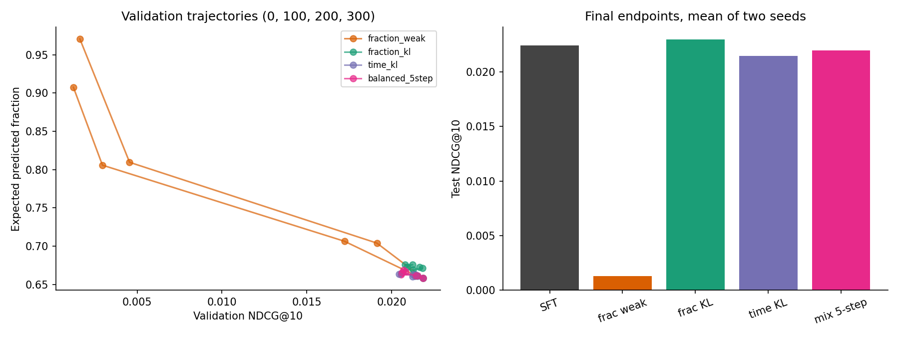
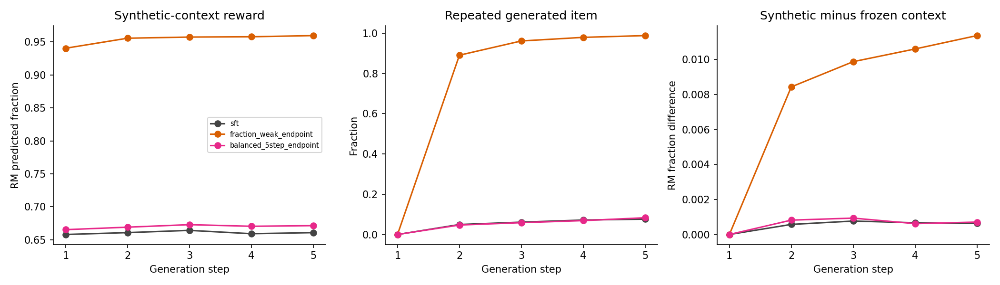

# RL-дообучение последовательной рекомендательной модели

## Результат эксперимента

Обучена небольшая GPT-2 с нуля на идентификаторах треков Yambda, построены
модель отклика и отдельный аудитор, выполнены четыре варианта RL на двух seed.
Все числа ниже получены выполнением кода в этой папке. Это вычислительно
ограниченный offline-эксперимент, а не репликация промышленных результатов статей.

На последнем шаге варианта «доля, KL=0.01» ожидаемая доля по оптимизируемой RM
изменилась на **+42.46%**, NDCG@10 — на **-94.20%** относительно SFT.
Они измеряют разные вещи: первое — прогноз обученной модели на выбранных
рекомендациях, второе — совпадение с реальными отложенными следующими событиями.
Прирост RM нельзя интерпретировать как наблюдаемый прирост удовлетворённости.

При сильном KL выбранная модель увеличила ожидаемую долю на
**2.22%**, средний NDCG — на
1.41%. Парные интервалы ΔNDCG включают
ноль на обоих seed, поэтому **значимое улучшение релевантности не обнаружено**.
Это локальный компромисс между прогнозируемой наградой и точностью, без
подтверждения реального выигрыша пользователей.

Основная таблица — checkpoint, выбранный **только на validation** с ограничением
NDCG@10 ≥ 95% от SFT. Если все RL-checkpoint нарушают ограничение или не улучшают
целевое вознаграждение, выбран шаг 0. Он тождествен SFT и не является успешным RL.
Усреднение двух seed описательное: test-данные у них общие.

| Метод | NDCG@10 | Recall@10 | RM: доля | Аудитор: доля | RM: секунды | KL |
| --- | --- | --- | --- | --- | --- | --- |
| Популярность | 0.00515 | 0.01354 | 0.68618 | 0.67994 | 85.77256 | 7.45365 |
| Последний + популярность | 0.01678 | 0.02477 | 0.68019 | 0.67405 | 99.10889 | 6.54555 |
| GPT-2 SFT | 0.02243 | 0.03720 | 0.65966 | 0.66027 | 127.86188 | 0.00000 |
| Доля, KL=0.01 | 0.02243 | 0.03720 | 0.65966 | 0.66027 | 127.86188 | 0.00000 |
| Доля, KL=0.2 | 0.02275 | 0.03870 | 0.67428 | 0.67456 | 128.75056 | 0.03744 |
| Время, KL=0.2 | 0.02148 | 0.03538 | 0.66237 | 0.66285 | 133.27148 | 0.03809 |
| Смесь, 5 шагов, KL=0.2 | 0.02201 | 0.03722 | 0.66493 | 0.66548 | 129.22141 | 0.02657 |

Все значения доли — в [0,1]. «RM: секунды» = E_pi[предсказанная доля × train median
длительности], без 600-секундного cap; в самой функции оптимизации времени cap
есть. Поэтому этот столбец может отличаться от целевой функции `time` × 300.
Аудиторская модель обучалась отдельно; её согласие с RM не доказывает верность.
Популярность и «последний + популярность» имеют детерминированное top-1 для
ожидаемой награды, тогда как GPT-2 оценивается по полному распределению. Их
reward/KL сравнения следует читать с учётом этого различия; ranking протокол общий.

## Данные и защита от утечек

Источник — [Yambda](https://huggingface.co/datasets/yandex/yambda), файл
`flat/50m/listens.parquet`, ревизия `dd6f3a19eef5866e346c3270e098baa641a44948`.
SHA256: `eed9cbd094af1e189507d2f8132a0dc9653b90e65480125c7cdccd601e0592d1`. Размер 369,110,332 байт.
Полный файл содержит 46,467,212 событий. Детерминированный хеш ID
выбирает примерно 10% пользователей: **916 пользователей,
4,484,526 событий**; все события выбранных пользователей сохранены.
Это подвыборка пользователей, а не обучение на полном Yambda-50M.

Время Yambda выражено в секундах относительно общего начала, округлённых до
пяти секунд: floor((T−T_start)/5)×5, согласно
[разделу 3.3 статьи о данных](https://arxiv.org/html/2505.22238v2#S3.SS3).
Границы по перцентилям времени выбранных пользователей: train < 19934415,
validation [19934415, 23086205), test ≥ 23086205.
Реальные календарные даты из этих индексов не выводятся. Для continuation
из каждого среза исключены последние 1800 секунд, то есть 30 минут.

| Срез | Событий для оценки/обучения | Пользователей | Цели в каталоге |
| --- | --- | --- | --- |
| train | 160000 | 777 | 1.00000 |
| validation | 4000 | 822 | 0.34250 |
| test | 4000 | 906 | 0.31975 |

Словарь — 4096 наиболее частых треков **по train** плюс PAD=0
и UNK=1. Доля train-событий, покрытая каталогом: 37.21%.
Неизвестные треки сохраняются в последовательностях как UNK; они не становятся
действиями policy. OOV-цель остаётся в denominator Recall/NDCG как промах.
Этот выбор ограничивает абсолютное качество и перенос выводов на длинный хвост.
Никакой test-item не добавляется в каталог или список кандидатов по ответу.
Скоринг — полный каталог, без сэмплированных отрицательных при оценке.

Каждая цель имеет минимум три предшествующих события. Контекст — последние
24 события с **timestamp строго меньше целевого**, включая неизвестные.
События с одинаковым timestamp не упорядочиваются искусственно и не попадают
друг к другу в историю. Входы не содержат долю прослушанного целевого трека.
Статистики и медианные длины треков вычислены только по train.

Validation/test содержат случайно до восьми целей на пользователя, максимум
4000 событий на срез. Сначала метрики усредняются по событиям пользователя,
затем по пользователям; активные пользователи не получают больший вес.
Это rolling next-event evaluation: для позднего test-события разрешены реальные
более ранние test-события в истории. Обучение на этих событиях не выполняется.
Исключённые холодные контексты и пользователи без событий не покрыты оценкой.

`played_ratio_pct` >100 встречается 21,833 раз: replay
частей трека допускается описанием датасета. Здесь целевая доля клиппируется
к 100%; информация о прослушивании сверх одной длины теряется намеренно.
Organic и recommendation-driven события смешаны; это дополнительное ограничение
для причинных выводов о рекомендательном воздействии.

## Базовая GPT-2

Используется настоящий `transformers.GPT2Model`, случайная инициализация,
2 decoder-блока, hidden size 64, 4 attention heads, learned position embeddings,
pre-layernorm, GELU и causal self-attention. Выходная матрица связана с item
embeddings, добавлен bias. Всего **368,002 параметров**.
Это малая модель на архитектуре GPT-2, не предобученная текстовая GPT-2.

Из train-контекстов случайно выбираются до 80 000 известных целей.
Оптимизируется full-catalog next-item cross entropy на последней позиции,
пять эпох AdamW, lr=0.001, batch=128, weight decay=0.01, gradient clip=1.
Dropout отключён, чтобы распределения sampling и gradient evaluation совпадали
на RL-этапе. Эпоха выбирается по validation NDCG@10 отдельно для каждого seed.
Веса SFT не переобучаются после выбора. Таблицы эпох доступны в reports.
На обоих seed выбрана пятая, последняя доступная эпоха; validation-качество
ещё росло. Поэтому baseline ограничен вычислительным бюджетом, сходимость
и оптимальность длительности pretraining не доказаны.

Метрики релевантности определены для одного следующего зарегистрированного
объекта: Recall@10 = 1 при попадании; NDCG@10 = 1/log2(rank+1);
MRR@10 = 1/rank, иначе ноль. Это предсказание следующего события, включая
неполные прослушивания; оно не равно точности предсказания лайка или хорошего
пользовательского опыта. Повтор ранее прослушанного трека разрешён всем методам:
в музыке повтор сам по себе не означает ошибку. Доля повторов измеряется отдельно.

## Модель вознаграждения

RM получает среднее embedding последних 24 item ID и embedding последнего
трека, пропускает их через MLP; два bilinear head с item embeddings и item bias
предсказывают долю и вероятность следующего зарегистрированного прослушивания
не позднее 30 минут. Item bias инициализирован сглаженными train item means
с 20 псевдонаблюдениями. Обе цели обучаются совместной MSE; для бинарного
выхода это Brier score. Восемь эпох AdamW, lr=0.003, batch=256;
выбор по средней validation MSE двух выходов.

До 160 000 train-целей делятся по чётности индекса на два непересекающихся
набора строк: половина для оптимизируемой RM, половина для аудитора.
Они используют разные seed, не делят веса, но имеют общий train item-mean prior
и пересекающихся пользователей. Поэтому аудитор — коррелированная диагностика
экстраполяции, не независимая истинная награда и не отдельный causal estimator.

Качество на **реальных известных test-событиях**, до выбора policy-действия:

| Seed | Модель | RMSE доли | MAE доли | Brier продолжения | AUC продолжения |
| --- | --- | --- | --- | --- | --- |
| 42 | reward_model | 0.43672 | 0.40253 | 0.06104 | 0.58346 |
| 42 | shuffled_history | 0.43641 | 0.40218 | 0.06099 | 0.59353 |
| 42 | item_mean | 0.43639 | 0.40280 | 0.06102 | 0.58043 |
| 42 | train_mean | 0.44206 | 0.41378 | 0.06149 | 0.50000 |
| 2026 | reward_model | 0.43675 | 0.40226 | 0.06108 | 0.58560 |
| 2026 | shuffled_history | 0.43790 | 0.40353 | 0.06111 | 0.58272 |
| 2026 | item_mean | 0.43639 | 0.40280 | 0.06102 | 0.58043 |
| 2026 | train_mean | 0.44206 | 0.41378 | 0.06149 | 0.50000 |

`train_mean` — константа по train-событиям; `item_mean` — сглаженные train-средние;
`shuffled_history` — та же RM с контекстами, случайно переставленными между
test-примерами. Контроль показывает, насколько RM использует соответствие
истории пользователю; хорошие агрегатные ошибки ещё не гарантируют точность
на рекомендациях, которых не было в логах. Калибровка по децилям и результаты
аудитора находятся в `reports/reward_quality.json`.

RM оценивает реакцию **условно на записанное событие прослушивания**. Без
экспозиций, непрослушанных показов и propensity нельзя считать её прогнозом
полной вероятности отклика на произвольный показ. Во время RL эта условная
модель экстраполируется на весь каталог, что и создаёт риск reward hacking.

Фактически RM почти не превосходит item-only контроль: средний RMSE доли
0.43674 против 0.43639 у сглаженного item mean, то есть немного
хуже. Перестановка истории не даёт устойчивого ухудшения: для seed=42 ошибка
даже чуть ниже, для 2026 — чуть выше. Это слабое свидетельство персонализации
RM: основную предсказательную силу обеспечивают item statistics. Все эти ошибки
посчитаны по 1279 известным
test-событиям и усредняют события, а не пользователей.
Continuation AUC около 0.58, против 0.50 у константы: сигнал слабый.
В обеих RM лучшая validation-эпоха ранняя; дальнейшее уменьшение train loss
сопровождается ростом validation loss. RL оптимизирует ранний выбранный checkpoint.

Согласие аудитора со слабым RL особенно показательно: средняя аудиторская
награда 0.94460 тоже намного выше исходной 0.66027,
но релевантность почти исчезает. Это надёжно показывает несоответствие
оптимизируемой цели ranking-качеству; **эксплуатация именно ошибок RM не доказана**.
Две модели могут одинаково правильно предсказывать высокий completion
определённых треков и при этом поощрять неперсональные рекомендации.

## RL: алгоритм и функции награды

Используется on-policy REINFORCE внутри замороженного симулятора RM.
State — история item ID, action — трек полного каталога. Actions сэмплируются
из текущей policy, без top-k truncation и temperature scaling. Реальных новых
откликов нет: это model-based offline fine-tuning, а не on-policy эксперимент
с пользователями и не off-policy REINFORCE по логам.

Для одного шага loss = −(R(s,a)−b(s)) log π(a|s) + β KL(π||π_SFT),
где b(s)=Σ_a π(a|s)R(s,a) вычисляется точно и отсоединяется от gradient.
KL также вычисляется точно по всему каталогу, reference SFT заморожен.
Для пяти шагов используется reward-to-go с gamma=0.95 и множителем gamma^t;
из каждого return вычитается state-only одношаговый baseline. Такой baseline
не смещает REINFORCE, но оставляет дисперсию будущих наград. KL добавляется
как средний локальный regularizer по посещённым состояниям; полный градиент
влияния ранних действий на распределение будущего KL отдельно не оценивается.

Один rollout используется для одного AdamW update, без повторного переигрывания
старых действий, clipping ratios и critic. 300 обновлений, batch 64,
lr=0.0001, weight decay=0, gradient clip=1. Все варианты стартуют от одной
SFT-модели внутри seed. Размеры и правила заданы до просмотра test в
[протоколе](reports/PROTOCOL.md) и `config.json`.

Четыре постановки:

1. **Доля, слабый KL:** R=fraction, β=0.01, H=1 — проверка агрессивной оптимизации RM.
2. **Доля, сильный KL:** R=fraction, β=0.2, H=1 — ограничение ухода от исходной модели.
3. **Время:** R=fraction × min(train median duration,600)/300, β=0.2, H=1.
   Cap снижает стимул рекомендовать аномально длинные треки, но не решает вопрос релевантности.
4. **Смесь, пять шагов:** R=0.5 fraction + 0.25 time + 0.25 continuation,
   β=0.2, H=5. Это иллюстративная scalarization, коэффициенты не подбирались по test.

Ограничение NDCG проверяется на шагах 0/100/200/300. Из допустимых checkpoint
выбирается максимальное **собственное одношаговое E_pi[R]** варианта на реальной
validation-истории. Для H=5 это также одношаговый surrogate отбора, не оценка
полного пятишагового return; это ограничение данного эксперимента.
Между разными функциями значения objective напрямую несопоставимы.

| Seed | Вариант | Шаг | Min val NDCG |
| --- | --- | --- | --- |
| 42 | Доля, KL=0.01 | 0 | 0.02076 |
| 42 | Доля, KL=0.2 | 300 | 0.02076 |
| 42 | Время, KL=0.2 | 300 | 0.02076 |
| 42 | Смесь, 5 шагов, KL=0.2 | 100 | 0.02076 |
| 2026 | Доля, KL=0.01 | 0 | 0.02035 |
| 2026 | Доля, KL=0.2 | 200 | 0.02035 |
| 2026 | Время, KL=0.2 | 300 | 0.02035 |
| 2026 | Смесь, 5 шагов, KL=0.2 | 300 | 0.02035 |

## Изменения поведения и компромисс с релевантностью

Следующая таблица использует **последнюю итерацию 300**, даже когда она
отклонена validation-ограничением. Это stress endpoint, не итоговая выбранная
модель. Она позволяет отделить эффект самого RL от возврата к SFT при выборе.

| Метод | NDCG@10 | Recall@10 | RM: доля | RM: секунды | Длина, с | Охват@10 | Max top-1 | Повтор@10 |
| --- | --- | --- | --- | --- | --- | --- | --- | --- |
| GPT-2 SFT | 0.02243 | 0.03720 | 0.65966 | 127.86188 | 196.17249 | 0.66821 | 0.11125 | 0.11899 |
| Доля, KL=0.01 | 0.00130 | 0.00201 | 0.93972 | 197.50478 | 209.65135 | 0.03894 | 0.99600 | 0.00458 |
| Доля, KL=0.2 | 0.02297 | 0.03895 | 0.67417 | 128.81702 | 193.46286 | 0.65613 | 0.11163 | 0.11651 |
| Время, KL=0.2 | 0.02148 | 0.03538 | 0.66237 | 133.27148 | 203.46654 | 0.66602 | 0.11300 | 0.11536 |
| Смесь, 5 шагов, KL=0.2 | 0.02195 | 0.03779 | 0.66637 | 129.30718 | 196.41168 | 0.66541 | 0.11238 | 0.11578 |

Охват — число разных треков в test top-10 / размер обученного каталога.
Max top-1 — доля самого часто встречающегося первого трека среди test-событий.
Повтор@10 — доля рекомендаций, уже присутствующих в последних 24 событиях.
Охват и max top-1 считаются по событиям; остальные средние — по пользователям.
Полная таблица дополнительно содержит entropy, concentration HHI, mean log
train popularity, MRR@10, пересечение top-10 с SFT и оценку continuation.

У слабого KL финальный NDCG@10=0.00130, у сильного
KL=0.02297, у SFT=0.02243. Сравнивать их нужно вместе
с вознаграждением и индивидуальными seed. Рост награды при снижении охвата
или концентрации на небольшом наборе треков — признак оптимизации RM,
а не доказательство персонализации. Изменение средней длины помогает
проверить гипотезу о предпочтении коротких объектов; этот эффект не следует
предполагать заранее, он может отсутствовать либо иметь обратный знак.

Здесь collapse наблюдается явно: охват top-10 упал с
66.82% до 3.89%, энтропия — с
6.683 до 0.750 нат, доля самого частого top-1 выросла с
11.12% до 99.60%. Почти всем пользователям
ставится первым один трек; у разных seed выбраны разные треки с высокими
train completion rates:

| Seed | Частый top-1 ID | Доля top-1 | Длина, с | Train-событий | Train-средняя доля (smooth) |
| --- | --- | --- | --- | --- | --- |
| 42 | 2463352 | 0.99375 | 220.00000 | 271 | 0.97642 |
| 2026 | 160462 | 0.99825 | 205.00000 | 258 | 0.92269 |

Гипотеза «модель выбирает короткие треки» для слабого KL **не подтвердилась**:
ожидаемая длина увеличилась с 196.2 до 209.7 с.
Повторы из реальных последних 24 событий тоже не стали основной проблемой:
их доля в top-10 снизилась с 11.90% до 0.46%.
Нежелательный эффект — общий неперсональный выбор и повторы уже внутри
искусственно генерируемого списка, а не возврат к знакомым реальным трекам.

Сильный fraction KL немного уменьшил ожидаемую длину до
193.3 с при сохранении охвата около
65.82%. Оптимизация времени увеличила
ожидаемую длину до 203.5 с и прогнозируемые секунды
на 4.23%, но средний NDCG снизился
на 4.26%. У time_kl seed=2026 интервал
ΔNDCG целиком ниже нуля, хотя checkpoint прошёл validation-порог.
Таким образом, возможность увеличить модельную награду с небольшой потерей
ranking-точности зависит и от reward, и от регуляризации; гарантии улучшения нет.
Одинаковое β не означает одинаковую эффективную силу ограничения при разных
масштабах reward. Здесь β и коэффициенты смеси не объявляются оптимальными.

Для оценки неопределённости применяется парный bootstrap пользователей,
2000 повторов, отдельно для каждого seed. Внутри bootstrap берутся все
выбранные события пользователя. Интервалы описывают вариативность test-пользователей
в одном временном периоде, не вариативность датасетов, будущих периодов
или всего процесса обучения. Примеров одного пользователя недостаточно
для независимого event-wise bootstrap.

| Seed | Вариант | ΔNDCG | 95% low | 95% high | ΔRM |
| --- | --- | --- | --- | --- | --- |
| 42 | Доля, KL=0.01 / selected | 0.00000 | 0.00000 | 0.00000 | 0.00000 |
| 42 | Доля, KL=0.01 / endpoint | -0.02073 | -0.02591 | -0.01590 | 0.31304 |
| 42 | Доля, KL=0.2 / selected | 0.00101 | -0.00010 | 0.00222 | 0.01479 |
| 42 | Доля, KL=0.2 / endpoint | 0.00101 | -0.00010 | 0.00222 | 0.01479 |
| 42 | Время, KL=0.2 / selected | -0.00009 | -0.00148 | 0.00131 | 0.00315 |
| 42 | Время, KL=0.2 / endpoint | -0.00009 | -0.00148 | 0.00131 | 0.00315 |
| 42 | Смесь, 5 шагов, KL=0.2 / selected | -0.00107 | -0.00221 | 0.00003 | 0.00335 |
| 42 | Смесь, 5 шагов, KL=0.2 / endpoint | -0.00119 | -0.00231 | -0.00009 | 0.00621 |
| 2026 | Доля, KL=0.01 / selected | 0.00000 | 0.00000 | 0.00000 | 0.00000 |
| 2026 | Доля, KL=0.01 / endpoint | -0.02153 | -0.02616 | -0.01741 | 0.24708 |
| 2026 | Доля, KL=0.2 / selected | -0.00038 | -0.00143 | 0.00066 | 0.01445 |
| 2026 | Доля, KL=0.2 / endpoint | 0.00006 | -0.00097 | 0.00111 | 0.01422 |
| 2026 | Время, KL=0.2 / selected | -0.00182 | -0.00313 | -0.00049 | 0.00227 |
| 2026 | Время, KL=0.2 / endpoint | -0.00182 | -0.00313 | -0.00049 | 0.00227 |
| 2026 | Смесь, 5 шагов, KL=0.2 / selected | 0.00022 | -0.00100 | 0.00147 | 0.00720 |
| 2026 | Смесь, 5 шагов, KL=0.2 / endpoint | 0.00022 | -0.00100 | 0.00147 | 0.00720 |

Только положительный интервал изменения релевантности поддерживает вывод
о статистически различимом улучшении на этом срезе. Интервал, включающий
ноль, не доказывает эквивалентность. Ограничение 95% на validation также не
гарантирует такую же потерю на test. Сравнение четырёх вариантов разведочное,
поправка на множественные сравнения не вводилась; победитель по test не выбирается.

## Генерация на пять шагов и сдвиг контекста

Для SFT и всех RL-endpoints сэмплируются пять треков, каждый добавляется
в контекст как будто он прослушан. Используются одни и те же случайно выбранные до 1024
test-контекстов и одинаковые seeds генератора. Поднабор фиксирован отдельным
seed и одинаков для всех моделей и обоих training seed. RM заново
оценивает реакцию на каждом синтетическом состоянии.

Параллельно **тот же сэмплированный трек** оценивается RM с исходной замороженной
историей. Разность synthetic/frozen показывает чувствительность RM к допущению
«рекомендованное = прослушанное». Это не второй реальный rollout с отказами,
и его нельзя назвать истинным откликом пользователя.

Дисконтированные пятишаговые суммы в том же симуляторе, сначала по траектории,
затем по пользователю и по двум seed. Все столбцы сравнимы между моделями,
но являются модельными оценками; аудиторский return использует только долю.

| Метод | Σγ^t RM-доля | Σγ^t аудитор | Σγ^t смесь |
| --- | --- | --- | --- |
| GPT-2 SFT | 2.98878 | 2.99108 | 3.04761 |
| Доля, KL=0.01 | 4.31592 | 4.35573 | 3.99726 |
| Доля, KL=0.2 | 3.07345 | 3.07547 | 3.09431 |
| Время, KL=0.2 | 3.00671 | 3.00944 | 3.08332 |
| Смесь, 5 шагов, KL=0.2 | 3.03007 | 3.03295 | 3.07492 |

В `reports/rollout_metrics.json` есть показатели по каждому шагу: награда RM
и аудитора, frozen-context reward, повторы внутри сгенерированной последовательности,
повторы из реальной истории, KL, NLL сэмплированного действия исходной SFT
на синтетической и исходной истории. NLL — дополнительный индикатор сдвига,
а не оценка причинной правдоподобности пользовательской траектории.
На шаге 1 synthetic и frozen reward совпадают по построению; дальнейшие
различия порождаются только изменением контекста.

На пятом шаге слабого RL повтор одного из ранее сгенерированных треков
встречается в среднем в **98.79%** траекторий. Для seed=42 NLL этого
действия у исходной SFT падает с 13.76 на первом шаге до 0.16 на пятом,
хотя NLL того же пятого действия на исходной frozen-истории остаётся 13.86.
Модель сама создаёт историю, в которой повтор выглядит правдоподобным.
Разность RM на synthetic/frozen контексте составляет около одного процентного
пункта, но сдвиг reference propensity гораздо сильнее. Поэтому одной проверки
стабильности прогнозов RM недостаточно для контроля многошаговой генерации.

Смесь H=5 не показывает убедительного преимущества над сильным одношаговым
RL: её mixed return в симуляторе ниже, чем у fraction_kl endpoint, при близкой
релевантности. Это не чистая абляция горизонта — одновременно отличается
функция награды. Чтобы приписать различие H, нужны H=1 и H=5 при одной и той
же награде, бюджете и процедуре отбора на новом validation-протоколе.

Технически это модель последовательного построения списка рекомендаций,
а не полноценная модель переходов состояния пользователя. Для реалистичного
MDP понадобятся отдельные вероятности принятия/пропуска/выхода и обновление
истории только по смоделированному отклику. Следует обучить переходы на логах,
проверить их на настоящих многошаговых траекториях и учитывать неопределённость.
Пятишаговый return текущего симулятора не доказывает долгосрочное улучшение.

Примеры с настоящими item ID, реальными целями и top-10 сохранены в
`reports/examples.json`. Названия песен не восстанавливаются: используемый
файл содержит анонимные идентификаторы. Полные сэмплированные траектории —
в `artifacts/seed_*/..._rollouts.csv`.

## Что можно сказать о долгосрочных целях

Сигнал «ещё одно событие в течение 30 минут» доступен из временных меток и
проверяется на holdout (Brier/AUC выше). Он коррелирует с продолжением сессии,
но не отделяет интерес пользователя от его свободного времени, автопроигрывания,
системы показа и позиции трека. Высокая вероятность продолжения сама по себе
не означает возвращение завтра или удовлетворённость.

Более содержательная постановка: дисконтированная сумма качественных
прослушиваний в сессии, затем отдельный бонус за возвращение через 1/7 дней,
со штрафом за быстрый пропуск/дизлайк и ограничением повторов/концентрации.
Возврат нужно задавать относительно конца сессии, применять одинаковое
окно наблюдения и исключать right-censored пользователей. Положительный
бонус следует ограничить, чтобы система не максимизировала бесконечное
прослушивание в ущерб выполнению задачи пользователя.

В расширении доступны likes/dislikes и is_organic; полезно разделить типы
трафика, анализировать музыкальные сессии и проверять calibration по группам.
Длительность сессии и число событий могут отражать причинно разные процессы,
поэтому веса reward стоит задавать с продуктовой гипотезой, а не выбирать
по максимальному simulator return.

Офлайн можно проверить предсказуемость таких меток во времени, temporal
generalization reward model, чувствительность к reward/β/горизонту,
support и uncertainty, повторы и концентрацию. При известных propensity
и достаточном overlap можно исследовать IPS/DR с effective sample size и
анализом clipping. Здесь propensity не предоставлены, IPS/DR не заявляются.
Для влияния рекомендаций на реальное возвращение и удовлетворённость нужен
онлайн A/B-тест с удержанием, качественными сигналами и ограничениями
по разнообразию/жалобам, а также период наблюдения, покрывающий целевой горизонт.

## Связь с предложенными работами

[Petrov & Macdonald, 2024](https://arxiv.org/abs/2403.04875) рассматривают
двухэтапное обучение GPTRec и Next-K generation для beyond-accuracy целей,
включая разнообразие и popularity bias. Здесь заимствована идея отделить
next-item pretraining от RL-выравнивания; teacher-student stage и PPO
этой работы не воспроизводятся.

[Matveev et al., 2026](https://arxiv.org/abs/2607.02818) используют session-level
off-policy REINFORCE, многошаговую поправку importance weights и user feedback
model для оценки. Здесь используется GPT-2 и on-policy sampling из симулятора,
без их off-policy correction, two-tower retrieval и doubly robust estimator.
Работа мотивирует явно обсуждать переходы состояния и достоверность offline
return, но её численные результаты к нашему эксперименту не относятся.

## Ограничения и следующие эксперименты

Размер модели, train subsampling, один временной срез, ограниченный каталог
и только два seed не позволяют делать универсальный вывод об эффективности RL
в рекомендательных системах. В исходном Yambda пользователи отбирались с
условием активности в конце периода наблюдения (статья о данных, §3.3);
это survivorship bias, особенно существенный для изучения ухода из сервиса.
RM обучена на условно наблюдаемых событиях;
её ошибки на действиях новой policy могут быть больше test RMSE.
Коррелированный аудитор обнаруживает лишь часть расхождений. Одинаковая
история у пользователей с разными неучтёнными обстоятельствами не задаёт
одинаковые потенциальные отклики.

Практические продолжения: расширить каталог/бюджет и проверить SFT saturation;
повторить на новых temporal folds; обучить ансамбль RM с uncertainty penalty;
добавить support-constrained generation; сравнить RL с простым reward reranking
и continued SFT при одинаковом бюджете; перейти к feedback-aware transitions;
подобрать β на заранее заданной validation Pareto curve; провести онлайн-проверку.
Эти эксперименты здесь не выполнены и не выдаются за результаты.

## Воспроизведение и артефакты

Полные команды в [README](README.md). Среда выполнения: Python 3.10.1,
PyTorch 2.9.1, transformers 4.57.3, CPU, четыре потока.
Обучение заняло 8.4 минут без загрузки/подготовки/финальной оценки.
Исходные веса, optimizer state не нужны для оценки: все выбранные и финальные
state_dict сохранены. Для переобучения используются сохранённые конфигурации,
ревизия данных, seed, таблицы выбора и SHA256 файлов кода в fit_manifest.
Побитовое совпадение на иной ОС/версии библиотек не гарантируется.

В текущей среде восемь unit-тестов прошли. Независимый повтор загрузки весов
и пересчёта воспроизвёл метрики и top-10 для 10/10 моделей (SFT и четыре
selected-варианта на каждом seed). Максимальное отличие агрегатных метрик
от CSV — менее 3×10⁻¹⁴; результаты — `reports/reproduction_checks.json`.

Основные результаты: `reports/test_metrics.csv`, `mean_metrics.csv`,
`paired_intervals.json`, `reward_quality.json`, `rollout_metrics.json`,
`selection.json`, `data_checks.json`, `fit_manifest.json`. Обучающие и validation
кривые сохранены отдельно по seed. Tests проверяют строгий timestamp cutoff,
OOV denominator, train-only catalog/prior, padding/causality GPT-2, переход
контекста, согласованность RM scoring и ожидаемый градиент REINFORCE.
